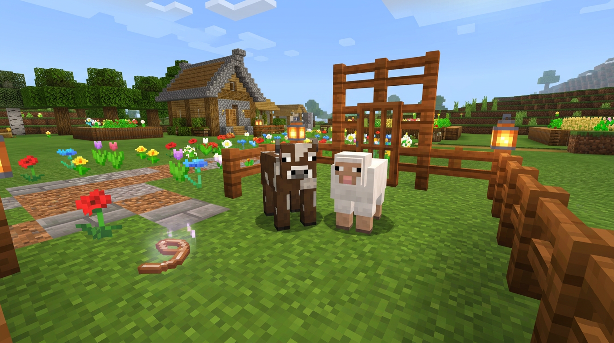

# Magische Leine

Magische Leinen können beim [Amin-Shop](../features/die-handler.md) am Spawn für [Adventure-Coins](../waehrungen/) gekauft werden. Sie ermöglichen es, Mobs in der Farmwelt einzufangen und später als Deko auf dem eigenen Plot freizulassen.

## So funktioniert das Item

1. Magische Leine in der Hand halten.
2. In der Farmwelt einen Mob mit Rechtsklick fangen.
3. Auf dem Plot mit Rechtsklick freilassen.


Um einem Mob auf dem Plot einen Namen zu geben, muss dieser in der Farmwelt mit einem Namensschild benannt und anschließend eingefangen werden.



Beim Einfangen werden viele Eigenschaften des Mobs gespeichert und beim Freilassen übernommen, z. B. Variante, Farbe oder Ausrüstung. Junge Tiere bleiben nach dem Freilassen jung und wachsen auf dem Grundstück nicht mehr.


<figure><figcaption>
Jungtiere bleiben auf dem Grundstück jung
</figcaption></figure>


* Mobs können nur in der Farmwelt gefangen und ausschließlich in der Plot-Welt freigelassen werden.
* Nach dem Freilassen des Mobs verschwindet die Leine.
* Mobs sind auf dem Plot nur Deko und haben keine Funktionen.



Eine Schritt-für-Schritt-Anleitung findest du auch unter [Mobs auf dem Grundstück](../grundstuecke/mobs-auf-dem-grundstuck.md).

