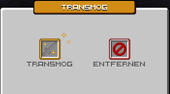

# Plot-NPC

<figure><figcaption>
Plot-NPC
</figcaption></figure>

Die Plot-NPCs können auf dem eigenen Grundstück platziert werden und werden dann an dieses Grundstück gebunden. Ein NPC kann verschiedene "Berufe" übernehmen, welche in den Einstellungen ausgewählt werden können. Ebenso kann der Plot-NPC verschiedene Optiken haben, welche ebenfalls gewählt werden können.


Achtung: Plot-NPCs werden beim Zurücksetzen oder Löschen des Grundstücks ebenfalls gelöscht.


## Zugriff auf den NPC

Bei einigen „Berufen“ möchte man den Zugriff auch für andere Spieler ermöglichen. Der Plot-NPC ist ohne weitere Einstellung von allen Spielern nutzbar, welche Rechte auf dem Grundstück haben. Möchtest du den NPC auch für andere Spieler freigeben, so muss die Flag **npc-interaction** auf **true** gesetzt werden. Das machst du mit dem folgenden Befehl: `/p flag set npc-interaction true`

## NPC einrichten

Um den NPC einzustellen, kann der NPC beim Ducken mit Rechtsklick angeklickt werden. Dann öffnet sich das Einstellungsfenster. Ebenfalls ist es möglich, mit dem Befehl `/plotnpc` eine Übersicht der auf dem Grundstück befindlichen NPCs zu öffnen und von dort aus die Einstellungen aufzurufen.


Der Plot-NPC kann nur vom Grundstücksbesitzer verwaltet werden.


<figure><figcaption>
NPC-Einstellungsmenü
</figcaption></figure>

Im Einstellungsmenü befinden sich folgende Optionen:

* Art des NPCs ändern (Spieler oder verschiedene Tiere & Monster)
* NPC-Einstellungen (z. B. Skin, Pose oder ob der NPC Spieler in der Nähe ansehen soll)
* Name des NPCs (legt den Anzeigenamen über dem Kopf fest)
* NPC-Funktion (legt den "Beruf" des NPCs fest, welcher ausgeführt werden soll)
* NPC-Position (Verschieben des NPCs und Anpassung z. B. der Blickrichtung)

### NPC-Arten / -Skins

Standardmäßig ist ein Plot-NPC ein Spieler, welcher den Skin des Besitzers trägt. Neben der Option eines Spielers stehen auch weitere Tiere & Monster zur Verfügung, welche in diesem Menü ausgewählt werden können.


Die Items zum Freischalten der verschiedenen Tiere können in den Farmwelten erhalten werden, indem man diese Tiere/Monster in der Farmwelt tötet. Mit einer gewissen Wahrscheinlichkeit droppen sie dann ein Item für die Freischaltung.



Die NPC-Arten werden beim Einlösen permanent für den Spieler freigeschaltet und nicht an einen NPC gebunden.



Skins, die du noch nicht freigeschaltet hast, kannst du im Menü in einer **Vorschau** ansehen, bevor du dich für eine Freischaltung entscheidest.


#### Transmog

Mit Transmog überträgst du die Optik eines Items auf ein anderes. Werte, Verzauberungen und der Name bleiben am Basis-Item. Geändert wird nur das Aussehen.
Im Hauptmenü wählst du Optik anwenden. Danach siehst du drei Felder: das Basis-Item, das Transmog-Item und das Ergebnis.

<figure><figcaption></figcaption></figure>

1. Klicke im Inventar auf das Item, dessen Optik verändert werden soll. Es landet im Feld Basis-Item.
2. Klicke auf das Item, dessen Optik übernommen werden soll. Es landet im Feld Transmog-Item.
3. Prüfe die Vorschau im Feld Ergebnis.
4. Klicke auf das Ergebnis und bestätige im nächsten Fenster.
5. Ein Klick auf ein belegtes Feld leert es wieder. Sind beide Felder belegt, musst du zuerst eines leeren, bevor du ein anderes Item wählst. Dasselbe Item kann nicht in beiden Feldern liegen.

Übernommen werden nur sichtbare Optik-Komponenten, die vom normalen Material abweichen:

- das Item-Modell
- die CustomModelData
- der Rüstungsbesatz (Trim)
- das Aussehen beim Anlegen, sofern das Basis-Item selbst angelegt werden kann


Das Transmog-Item wird bei der Übertragung verbraucht. Liegt ein Stapel im Slot, wird ein Item davon entfernt.
Nicht jede Kombination ist möglich. Das Menü zeigt dann Nicht möglich. Rüstung übernimmt das Aussehen beim Anlegen nur von einem Item, das selbst eine Anlege-Optik mitbringt. Sonst wäre das neue Aussehen beim Tragen nicht sichtbar.


Mit Optik entfernen setzt du einzelne Optik-Komponenten eines Items auf den Standard des Materials zurück. Das Item selbst bleibt erhalten, und es wird kein zweites Item verbraucht.

1. Klicke im Inventar auf das Item, dessen Optik zurückgesetzt werden soll.
2. Wähle unten die Komponenten aus, die du entfernen willst. Bereits veränderte Komponenten sind vorausgewählt.
3. Prüfe die Vorschau und bestätige.

Zur Auswahl stehen ItemModel, CustomModelData, Trim und Equippable. Komponenten, die auf dem Item nicht verändert sind, lassen sich nicht auswählen. Hat das Item gar keine veränderte Optik, kannst du es nicht einlegen.


Beim Zurücksetzen von Equippable bleibt Rüstung Rüstung und Papier bleibt Papier. Es wird nur die abweichende Optik entfernt.


### NPC-Einstellungen

Hier können je nach NPC-Art verschiedene Einstellungen getroffen werden. Für einen "Spieler-NPC" stehen zum Beispiel der Skin oder die Pose zur Verfügung.

Die Option **Spieler ansehen** legt fest, ob der NPC den Spieler anschaut oder weiter in seiner Position verbleibt.


Mit Minecraft 26.2 sind viele neue Einstellungen für Tiere und Monster dazugekommen, auch für die neuen Mobs und Varianten. Der Großteil davon steht allen Spielern zur Verfügung. Einstellungen, die zur gewählten NPC-Art nicht passen, werden im Menü trotzdem angezeigt, wirken sich dann aber nicht aus.


### NPC-Funktionen

Jeder NPC kann einen „Beruf“ bzw. eine Funktion ausüben. Aktuell gibt es die folgenden Funktionen:

<table><thead><tr><th width="198">Funktion</th><th width="358">Beschreibung</th><th>Erhalten durch</th></tr></thead><tbody><tr><td>Showcase</td><td>Ermöglicht den NPC als Showcase einer Kiste o. Ä. zu verwenden, um diese nicht freigeben zu müssen.</td><td>Freigeschaltet für jeden Spieler.</td></tr><tr><td>Händler</td><td>Ermöglicht den Zugriff auf den Händler auf dem Grundstück.</td><td>Händler sind, sofern nicht gesondert aufgeführt, für alle Spieler freigegeben.</td></tr><tr><td>Amin-Shop</td><td>Ermöglicht den Zugriff auf den Amin-Shop.</td><td>--</td></tr><tr><td>Jobs</td><td>Ermöglicht den Zugriff &#x26; Verwendung des Job-NPCs.</td><td>Case-Opening</td></tr><tr><td>MiniGames</td><td>Zugriff auf das MiniGames-Inventar (später weitere Optionen).</td><td>--</td></tr><tr><td>Abenteurer</td><td>Zugriff auf die Aufgaben des Abenteurers.</td><td>--</td></tr><tr><td>Block des Tages</td><td>Zugriff auf das Block des Tages-Menü.</td><td>--</td></tr><tr><td>Auktionshaus</td><td>Zugriff auf das Auktionshaus.</td><td>--</td></tr><tr><td>Immobilienbörse</td><td>Zugriff auf die <a href="immobilienboerse.md">Immobilienbörse</a>.</td><td>--</td></tr><tr><td>Transmog</td><td>Überträgt die Optik eines Items auf ein anderes Item oder entfernt sie wieder.</td><td>--</td></tr></tbody></table>

#### Einstellungen in der Funktion

Manche Funktionen des Plot-NPCs benötigen weitere Einrichtung, wie zum Beispiel die Showcase-Funktion. Um diese einzustellen, muss nach dem Auswählen der Funktion erneut auf den Funktionsknopf gedrückt werden.

Dort können dann weitere Einstellungen für diese Option durchgeführt werden. Bei der Showcase-Funktion kann dort die Auswahl der Zielkiste gestartet werden.
