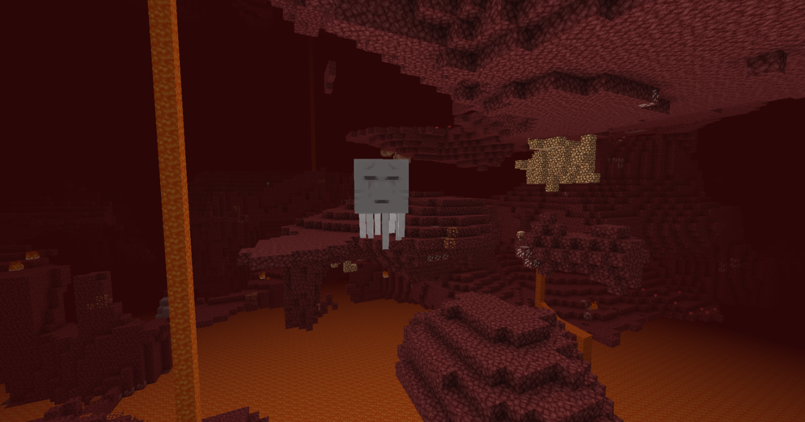
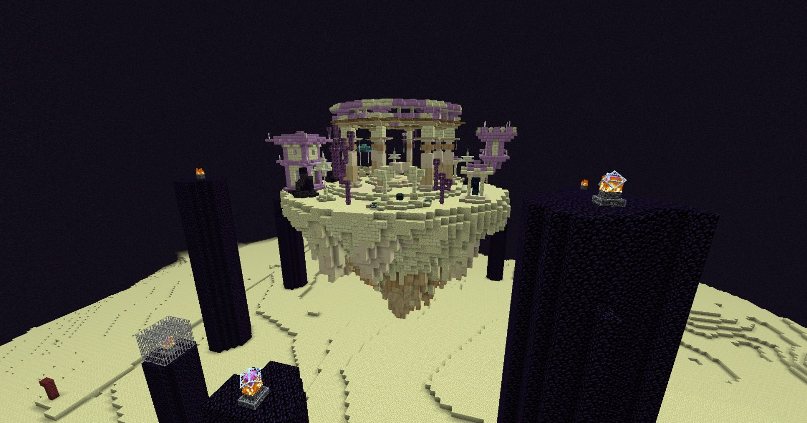

# 🌳 Die Farmwelten

<figure><figcaption>
Spawn der Farmwelten
</figcaption></figure>

Das Cloud-Netzwerk hat mehrere Farmwelten, welche komplett eigenständige Welten sind. Die Server unterscheiden sich in der Anordnung der Biome, Strukturen und Elemente. Kurz gesagt: Jede Welt hat ihre eigenen Seeds.

Jede Farmwelt reicht in allen Dimensionen **20.000 Blöcke** weit in jede Richtung vom Spawn. Dort liegt die Weltgrenze.


Die Farmwelten werden **jeden Monat in der Nacht vom 3. auf den 4. Tag** zurückgesetzt und alle Homes in den Farmwelten gelöscht.


## In die Farmwelt gelangen

Um in die Farmwelt zu gelangen, kann der Befehl `/farm` verwendet werden. Des Weiteren kann das Farm-Menü auch über die Hilfe unter `/?` oder durch das Farm-Portal am Spawn erreicht werden.

Im Farm-Menü wählst du, ob du in die **Overworld**, den **Nether** oder das **End** möchtest. Den Farm-Server sucht das System automatisch für dich aus. Wählst du Nether oder End, landest du direkt am Spawn dieser Dimension.


Ab dem [**Griefer-Rang**](../grundbefehle/range/griefer-rang.md) kann unter `/farm` auch der gewünschte Farm-Server gewählt werden. Bei jedem Server siehst du, wie viele **Spieler** gerade dort sind und wie seine **Auslastung** ist. Über „Farm-Server betreten“ kommst du weiterhin zur Wahl der Dimension mit automatischer Serverauswahl.


Damit du erkennst, in welcher Farmwelt du dich befindest, wird in der Tabliste über den Spielern die aktuelle Region angezeigt.

<figure><figcaption>
Anzeige der Region in der Tabliste
</figcaption></figure>

## Spawn & Spawn-Protection

<figure><figcaption></figcaption></figure>

Jede Farmwelt hat in allen Dimensionen einen eigenen Spawn. Dieser ist durch eine Spawn-Protection geschützt, in welcher keine Blöcke platziert oder abgebaut werden können.

Im Spawn-Bereich erhältst du keinen Schaden und bekommst keinen Hunger. Fällst du dort ins Void, stirbst du nicht und wirst auf die Plattform in der Overworld teleportiert.

### Die Overworld

In der Overworld kannst du einfach von der Plattform springen und du erhältst den Effekt **Langsamer Fall**. Des Weiteren befinden sich auf der Plattform ein Endportal, um ins End zu gelangen, und ein Netherportal, um in den Nether zu gelangen.

Sobald du außerhalb des Spawn-Bereichs landest, wird der Effekt **Langsamer Fall** wieder entfernt.


Eigene Netherportale kannst du in den Farmwelten nicht entzünden. Nutze die Portale auf der Plattform, die du mit `/warp Plattform` erreichst.


#### Änderungen

* Die AI der Villager ist reduziert.
* Die Bevölkerung in Dörfern ist begrenzt.

### Der Nether

Auf der Cloud erreichst du den Nether über die Farmwelten. Gib dazu einfach `/farm` ein und wähle im Menü den Nether aus – so landest du direkt am Nether-Spawn. Alternativ kannst du auch durch das Netherportal auf der Spawn-Plattform der Overworld gehen, zu der du mit `/warp Plattform` gelangst.

<figure><figcaption></figcaption></figure>

Rund um den Nether-Spawn liegt ein Schutzbereich, der exakt so groß ist wie die Plattform selbst. Innerhalb dieses Bereichs bekommst du keinen Schaden. Direkt am Rand der Plattform endet dieser Schutz: Ab hier kannst du Blöcke abbauen und platzieren, um dir einen Weg weiter in den Nether zu bahnen. Am Spawn befindet sich natürlich auch ein Netherportal, um jederzeit sicher in die Overworld zurückgelangen zu können.


**Achtung bei Lava und Feuer!**
Stirbst du im Nether in Lava oder Feuer, wird **keine Todeskiste** generiert. Deine Items fallen dann ganz normal zu Boden und verbrennen sofort. Schutz davor bietet beispielsweise das Perk *Feuerresistenz* (siehe **Perks**). 


#### Änderungen

- Die Netherdecke oberhalb der Grundgestein-Schicht ist gesperrt und nicht betretbar.
- Eigene Netherportale lassen sich in den Farmwelten nicht entzünden. Nutze für die Reise immer die Portale auf der Plattform.

### Das End

Das End ist die dritte Dimension von Minecraft: schwebende Inseln aus Endstein über dem Nichts, dazu Endermen, Endstädte und Shulker. Auf der Cloud erreichst du das End ganz einfach über die Farmwelten:

<figure><figcaption></figcaption></figure>

- Gib `/farm` ein und wähle im Menü das End. Du landest direkt am End-Spawn. Auch `/warp end` funktioniert.
- Alternativ kannst du durch das Endportal auf der Plattform der Overworld gehen. 

Der End-Spawn liegt mitten auf der großen Hauptinsel. Sie besteht aus Endstein und schwebt über dem absoluten Nichts. Im direkten Spawn-Bereich bist du geschützt: Du erhältst dort den Effekt **Langsamer Fall** und bekommst keinen Schaden. Fällst du am Spawn ins Nichts, stirbst du nicht, sondern landest sicher wieder auf der Plattform in der Overworld.

Damit du dich nicht erst Hunderte Blöcke weit durch die Leere bauen musst, stehen direkt am Spawn praktische Portale zur Verfügung:
- An zwei Ecken der Spawn-Plattform findest du **End-Gateways**. Sie teleportieren dich direkt in das erweiterte (äußere) End.
- An einer anderen Ecke befindet sich ein kleines 1-Block-Endportal, mit dem du jederzeit zurück in die Overworld gelangst.

Hinter den Gateways liegen viele große und kleine Inseln – das sogenannte erweiterte End. Dort findest du Choruspflanzen, Massen an Endermen und vor allem die begehrten Endstädte. 
**Aber Vorsicht:** Hier gibt es keinen Schutz mehr! Wer hier ins Nichts fällt, stirbt und verliert seine Items.

Endstädte (auch Endsiedlungen genannt) sind markante, hohe Türme aus lila Purpurblöcken und Endsteinziegeln, die von leuchtenden Endstäben erhellt werden. Oben in den Türmen stehen Truhen mit wertvoller Beute. Manchmal schwebt direkt daneben auch ein Endschiff.

## Besonderheiten auf GrieferGames

Da das End ein Teil der Farmwelten ist, gibt es hier einige entscheidende Unterschiede zum Singleplayer (siehe auch im Beitrag **[Mechanik-Änderungen](https://wiki.griefergames.net/cloud/funktionen/mechanik-aenderungen)**):

* Die Droprate der Shulker-Schalen ist geringer als im Singleplayer.
* Die AI der Shulker ist angepasst (keine Teleportation).
* Der Enderdrache ist nicht vorhanden.
* Es sind keine Elytren in den Endcitys.


Da **Shulker** nicht natürlich nachspawnen oder sich vermehren, funktionieren klassische Shulker-Farmen auf der Cloud nicht.
*
*In **Shulker-Kisten** kannst du keine Bücher legen. Baust du eine Kiste ab, landet sie direkt in deinem Inventar. 

