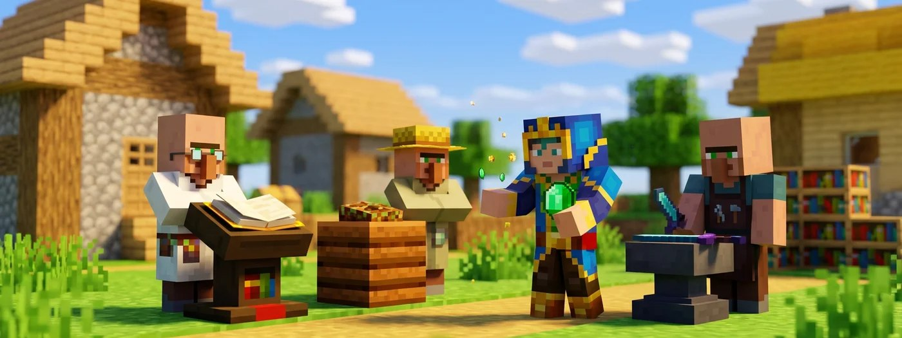

# 🧑‍🌾 Dorfbewohner & Handel

---

Dorfbewohner tauschen Smaragde gegen nützliche Dinge, von verzauberten Büchern bis zu Diamantausrüstung. Hier erfährst du, wie sie zu ihrem Beruf kommen, wie du an gute Angebote kommst und wo du auf GrieferGames mit ihnen handeln kannst.

<figure><figcaption></figcaption></figure>


Dörfer findest du in der Overworld der **[Farmwelten](https://wiki.griefergames.net/cloud/funktionen/spielmodus-citybuild/die-farmwelten)**. Nur dort kannst du mit Dorfbewohnern handeln. Auf Grundstücken im Citybuild sind Mobs reine Deko: Du kannst nicht mit ihnen interagieren, also auch nicht handeln oder sie vermehren. 


## Berufe und Arbeitsblöcke

Ein erwachsener Dorfbewohner ohne Beruf sucht sich in seinem Dorf einen freien Arbeitsblock. Sobald er einen für sich beansprucht, bekommt er den passenden Beruf. Jeder Dorfbewohner braucht zwingend seinen eigenen Block.

| Arbeitsblock | Beruf |
| :--- | :--- |
| **Bognertisch** | Pfeilmacher |
| **Braustand** | Geistlicher |
| **Fass** | Fischer |
| **Kartentisch** | Kartograf |
| **Kessel** | Gerber |
| **Komposter** | Bauer |
| **Lesepult** | Bibliothekar |
| **Räucherofen** | Metzger |
| **Schleifstein** | Waffenschmied |
| **Schmelzofen** | Panzermacher |
| **Schmiedetisch** | Grobschmied |
| **Steinsäge** | Maurer |
| **Webstuhl** | Schäfer |


Ein Dorfbewohner wird beispielsweise zum Bibliothekar, sobald er ein freies Lesepult für sich beansprucht. 
**Kartentische** sind auf der Cloud übrigens deaktiviert (siehe **[Mechanik-Änderungen](https://wiki.griefergames.net/cloud/funktionen/mechanik-aenderungen#deaktivierte-bl%C3%B6cke)**).


Ein Dorfbewohner schüttelt den Kopf, wenn er nicht handeln kann. Das hat meist einen dieser Gründe:
- **Er hat keinen Beruf:** Dann trägt er nur die normale Kleidung seines Bioms, ohne Berufskleidung. Stell einfach einen freien Arbeitsblock in seine Nähe.
- **Er ist ein Nichtsnutz:** Dorfbewohner in grüner Robe nehmen nie einen Beruf an. Mit ihnen kannst du generell nicht handeln.
- **Er ist ein Kind:** Kinder handeln noch nicht.

## Handeln und Karrierestufen

Bezahlt wird fast immer mit Smaragden. Mit jedem Handel sammelt der Dorfbewohner Erfahrung und steigt auf: *Neuling, Lehrling, Geselle, Experte* und am Ende *Meister*. Mit jeder Stufe kommen neue Angebote dazu, die alten bleiben. Die Stufe erkennst du am farbigen Abzeichen an seiner Kleidung.

- **Ausverkauft:** Ein oft genutztes Angebot wird irgendwann gesperrt und zeigt ein rotes X. Der Dorfbewohner füllt es wieder auf, wenn er an seinem Arbeitsblock arbeitet (bis zu zweimal am Tag).
- **Der erste Handel legt ihn fest:** Hast du einmal mit ihm gehandelt, behält er seinen Beruf und seine Angebote für immer.


**Angebote neu würfeln:** Hast du noch **nie** mit dem Dorfbewohner gehandelt und dir gefällt sein Angebot nicht, bau seinen Arbeitsblock ab und stell ihn wieder hin. Er verliert seinen Beruf, nimmt ihn direkt neu an und bekommt neue Angebote.


## Reparatur vom Bibliothekar

Bibliothekare können auf den Stufen *Neuling* bis *Experte* zufällige verzauberte Bücher anbieten, darunter auch die beliebte Verzauberung *Reparatur*. So kommst du gezielt daran:

1. Stell ein Lesepult neben einen Dorfbewohner ohne Beruf.
2. Ist kein Reparatur-Buch im Angebot, bau das Lesepult ab und stell es neu hin.
3. Wiederhole das so oft, bis Reparatur angeboten wird. Kauf es dann sofort einmal, damit das Angebot feststeht.

Ein Reparatur-Buch kostet ohne Rabatt 1 Buch und 10 bis 38 Smaragde. Wie du es auf deine Ausrüstung bringst, steht unter **[Verzaubern & Reparieren](https://wiki.griefergames.net/cloud/funktionen/tutorials/verzaubernundreparieren)**.

## Günstiger handeln

Um bei Dorfbewohnern günstigere Preise herauszuschlagen, gibt es verschiedene Wege. Der effektivste ist das Heilen eines Zombiedorfbewohners: Bewirf ihn zunächst mit einem Wurftrank der Schwäche und gib ihm anschließend einen goldenen Apfel. Nach einer kurzen Wartezeit verwandelt er sich zurück in einen normalen Dorfbewohner und gewährt dir als Dank einen gewaltigen Rabatt. Beachte jedoch, dass es diesen Preisnachlass pro Dorfbewohner nur beim allerersten Heilen gibt. 

Eine weitere Möglichkeit ist der Effekt **Held des Dorfes**. Wenn du einen Überfall erfolgreich abwehrst, erhältst du diesen Bonus für 40 Minuten, wodurch alle Dorfbewohner in dieser Zeit ihre Preise deutlich senken. Pass aber auf, wie du dich verhältst: Greifst du Dorfbewohner an, machen sie ihre Angebote für dich zur Strafe teurer.

## Dorfbewohner vermehren

Zwei Dorfbewohner bekommen nur dann ein Kind, wenn beides stimmt:
1. **Betten:** Im Dorf gibt es mehr Betten als Dorfbewohner. Über jedem Bett müssen zudem zwei Blöcke frei sein (damit die Kinder auf den Betten springen können).
2. **Essen:** Jeder der beiden hat 3 Brot oder 12 Karotten, Kartoffeln oder Rote Bete im Inventar. Wirf ihnen das Essen einfach zu, sie heben es auf.

Treffen sich zwei bereite Dorfbewohner, steigen Herzen auf, und kurz danach erscheint ein Kind.

## Überfälle und Drohendes Unheil

Ein Plünderer mit einem Banner auf dem Kopf ist ein Illager-Anführer. Tötest du ihn, lässt er eine *Unheilvolle Flasche* fallen. Trinkst du sie, bekommst du den Effekt **Drohendes Unheil** (oft auch „Böses Omen“ genannt). 

Betrittst du damit ein Dorf, beginnt kurz darauf ein Überfall: Mehrere Wellen aus Illagern und Hexen greifen das Dorf an. Besiegst du alle, wirst du zum *Held des Dorfes*. Willst du erst gar keinen Überfall auslösen, trink vorher einfach Milch. Das entfernt den Effekt.

## [#](#dorfbewohner-auf-griefergames)Änderungen auf GrieferGames

- **Farmwelt:** In der Overworld der Farmwelten ist die AI (Künstliche Intelligenz) der Dorfbewohner etwas reduziert und ihre Anzahl ist begrenzt, um Lags zu vermeiden.
- **Boote und Loren:** Sitzt ein Dorfbewohner in der Farmwelt in einem Fahrzeug, ist seine AI komplett ausgeschaltet. Dort kann er nicht arbeiten und bekommt keine neuen Angebote (füllt sein rotes X nicht auf). Lass ihn aussteigen, dann ist die AI wieder an.
- **Grundstücke:** Mit der **Magischen Leine** fängst du einen Dorfbewohner in der Farmwelt und lässt ihn auf deinem Grundstück frei. Dort ist er **nur Deko** und hat keine Funktion. Soll er einen Namen tragen, benenne ihn unbedingt vor dem Einfangen mit einem Namensschild. Mehr unter ****[**Mobs auf dem Grundstück**.](https://wiki.griefergames.net/cloud/funktionen/grundstuecke/mobs-auf-dem-grundstuck)
