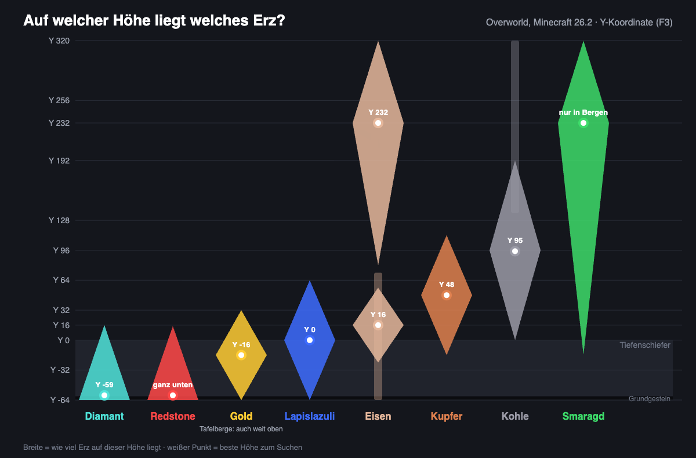

# ⛏️ Erze & Diamanten finden

Erze liegen in Minecraft nicht überall gleich häufig. Jedes Erz hat seinen eigenen Höhenbereich, und meist eine Höhe, auf der es besonders oft vorkommt. Wer dort sucht, findet deutlich mehr. Hier steht, wo du suchen solltest.

## Deine Höhe herausfinden

Die Höhe ist die Y-Koordinate. In der Java Edition drückst du F3. Die Y-Koordinate steht in der Zeile „XYZ“ an zweiter Stelle.

Die Welt reicht von Y -64 ganz unten bis Y 320 ganz oben. Ab etwa Y 0 abwärts besteht der Untergrund aus Tiefenschiefer. Der ist härter und lässt sich langsamer abbauen, die Erze darin heißen z. B. Tiefenschiefer-Diamanterz.

## Welches Erz wo liegt

Je breiter der Balken, desto mehr Erz liegt auf dieser Höhe. Diamanten, Redstone und Gold findest du tief unten, Smaragde und viel Eisen hoch oben in Bergen.

<figure><figcaption></figcaption></figure>

| Erz | Kommt vor zwischen | Am häufigsten | Tipp |
| :--- | :--- | :--- | :--- |
| **Diamant** | Y -64 bis 16 | ganz unten, um Y -59 | Siehe unten |
| **Redstone** | Y -64 bis 15 | ganz unten | Fällt beim Diamantensuchen nebenbei mit ab |
| **Gold** | Y -64 bis 32 | um Y -16 | In Tafelbergen (Badlands) zusätzlich weit oben |
| **Lapislazuli** | Y -64 bis 64 | um Y 0 | Brauchst du zum Verzaubern |
| **Eisen** | fast überall | um Y 16 und hoch in Bergen um Y 232 | Zwei gute Höhen, oben in Bergen sogar noch mehr |
| **Kupfer** | Y -16 bis 112 | um Y 48 | In Tropfsteinhöhlen besonders viel |
| **Kohle** | Y 0 bis 320 | um Y 95 | Liegt oft offen an Höhlenwänden |
| **Smaragd** | nur in Bergen | je höher, desto mehr | Einfacher: mit Dorfbewohnern handeln |

## Diamanten

Diamanten liegen zwischen Y -64 und Y 16, und je tiefer, desto mehr. Am meisten findest du knapp über dem Grundgestein.


**Der beste Weg:** Grabe dich auf Y -58 hinunter und baue dort einen langen, geraden Tunnel, zwei Blöcke hoch. Darunter beginnt das Grundgestein, darüber liegen die meisten Diamanten in Reichweite.


Beim Suchen lohnt es sich mehr, Tunnel zu schlagen statt Höhlen abzusuchen. Diamanten liegen selten offen an der Luft, weshalb du in Höhlen nur einen Teil davon siehst – ein Tunnel durch festes Gestein findet mehr. Da es tief unten viele Lavaseen gibt, solltest du immer einen Wassereimer bereithalten und nie direkt unter dir graben. 
Außerdem lohnt sich die Verzauberung Glück: Mit Glück III bekommst du aus einem Diamanterz im Schnitt deutlich mehr als einen Diamanten. Mehr zu Glück und Behutsamkeit findest du unter [Verzaubern & Reparieren](https://wiki.griefergames.net/cloud/funktionen/tutorials/verzaubernundreparieren).

## Netherit

Netherit stellst du aus Antikem Schrott her, den es nur im Nether gibt. Er liegt zwischen Y 8 und Y 119, mit Abstand am meisten findest du jedoch um Y 15. 
Da Antiker Schrott fast nie offen an der Luft liegt, gräbst du auf Y 15 am besten lange Tunnel durch den Netherrack. Die Verzauberung Glück bringt beim Abbauen nichts – du bekommst immer genau einen Block.

**So wird daraus Netherit-Ausrüstung:**

1. Antiken Schrott im Ofen zu Netheritplatten schmelzen.
2. 4 Netheritplatten und 4 Goldbarren in der Werkbank zu 1 Netheritbarren verarbeiten.
3. Am Schmiedetisch Diamant-Ausrüstung mit einem Netheritbarren und einer Netherit-Aufwertung zu Netherit-Ausrüstung aufwerten. Die Verzauberungen bleiben dabei erhalten.


Die **Netherit-Aufwertung** ist eine Schmiedevorlage. Du findest sie in Truhen in Bastionsruinen im Nether. Mit 7 Diamanten und 1 Netherrack kannst du sie in der Werkbank vervielfältigen.


## Rohstoffe, Glück und Behutsamkeit

- **Eisen, Gold** und **Kupfer** droppen als **Rohstoffe** (z. B. Roheisen). Die schmilzt du im Ofen zu Barren. Glück erhöht auch die Zahl der Rohstoffe.
- **Diamant, Kohle, Lapislazuli, Redstone, Smaragd** und **Netherquarz** droppen direkt. Glück bringt hier mehr Drops.
- Mit **Behutsamkeit** bekommst du das Erz als Block. Das lohnt sich, wenn du später mit einem Glück-Werkzeug abbauen willst.

## Erze farmen auf GrieferGames

Erze baust du in den [Farmwelten](https://wiki.griefergames.net/cloud/funktionen/spielmodus-citybuild/die-farmwelten) ab. Mit `/farm` wählst du Overworld, Nether oder End.

- Rund um den Spawn ist ein Schutzbereich. Dort kannst du nichts abbauen.
- Jede Farmwelt reicht 20.000 Blöcke weit in jede Richtung.
- Die Farmwelten werden **jeden Monat in der Nacht vom 3. auf den 4.** zurückgesetzt. Danach liegen überall wieder frische Erze.


Stirbst du in der Farmwelt, landen deine Items in einer **Todeskiste** am Todespunkt. 
In Lava gibt es keine Todeskiste, dann sind die Items weg. Mehr dazu unter [Mechanik-Änderungen](https://wiki.griefergames.net/cloud/funktionen/mechanik-aenderungen#todeskisten).

