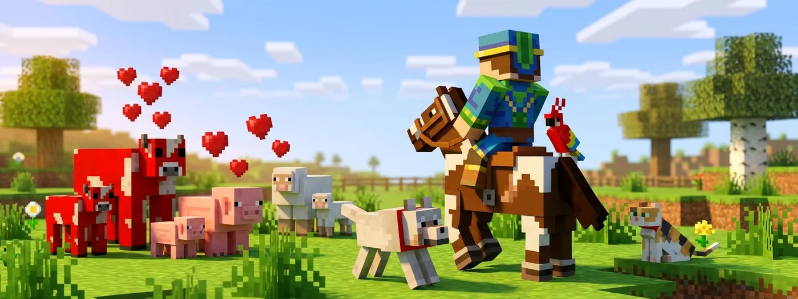

# 🐴 Tiere zähmen & züchten

Mit dem richtigen Futter vermehrst du Tiere und machst sie zu deinen Begleitern. Hier erfährst du, wer was frisst, wie das Zähmen funktioniert und was auf GrieferGames zu beachten ist.

<figure><figcaption></figcaption></figure>


**Besonderheit auf GrieferGames:**
Mit Mobs auf Citybuild-Grundstücken kannst du nicht interagieren! Du kannst sie dort nicht füttern, melken, anleinen oder vermehren. Zähmen und Züchten funktioniert **nur in den Farmwelten**.


## Tiere anlocken und vermehren

Hältst du das Lieblingsfutter eines Tieres in der Hand, läuft es dir hinterher. Klickst du damit auf zwei erwachsene Tiere derselben Art, steigen Herzen auf und sie bekommen ein Jungtier (erneute Paarung nach 5 Minuten möglich). Jungtiere brauchen etwa 20 Minuten zum Wachsen – fütterst du sie, geht es schneller.

| Tier | Futter für die Zucht |
| :--- | :--- |
| **Kuh, Mooshroom, Schaf, Ziege** | Weizen |
| **Schwein** | Karotte, Kartoffel, Rote Bete |
| **Huhn** | Samen (z. B. Weizen, Melone, Kürbis) |
| **Kaninchen** | Karotte, Goldene Karotte, Löwenzahn |
| **Pferd, Esel** | Goldene Karotte, Goldener Apfel *(nur gezähmt)* |
| **Lama** | Strohballen *(nur gezähmt)* |
| **Biene** | Blumen |
| **Schildkröte** | Seegras |
| **Fuchs** | Süßbeeren, Leuchtbeeren |

<figure><figcaption></figcaption></figure>


**Papageien** lassen sich in Minecraft nicht vermehren.


## Reit- und Haustiere zähmen

Einige Tiere kannst du zu deinen persönlichen Begleitern machen. Die Art des Zähmens unterscheidet sich dabei je nach Tier:

- **Reittiere (Pferde, Esel, Lamas):** Klicke mit *leerer Hand* auf das Tier, um aufzusteigen, bis Herzen erscheinen und es dich nicht mehr abwirft. Mit einem **Sattel** kannst du Pferde und Esel lenken, Pferde lassen sich zusätzlich mit einem Rossharnisch schützen. Esel, Maultiere und Lamas können stattdessen mit einem Rechtsklick eine **Truhe** tragen.
- **Haustiere (Wölfe, Katzen, Papageien):** Du zähmst Wölfe mit **Knochen**, Katzen mit **rohem Fisch** und Papageien mit **Samen**. Jeder Versuch hat nur eine prozentuale Erfolgschance. Einmal gezähmt, folgen sie dir, teleportieren sich zu dir und können mit einem Rechtsklick auf „Sitz“ gestellt werden. 


**Achtung:** Gib Papageien niemals Kekse, das tötet sie sofort!



**Ozelots** lassen sich zudem nicht mehr klassisch zähmen, man kann mit Fisch nur ihr Vertrauen gewinnen, damit sie nicht mehr weglaufen.


## Leinen & Tiere auf GrieferGames

Mit einer normalen **Leine** führst du Tiere herum oder bindest sie an einem Zaun fest. Entfernst du dich zu weit, reißt sie.
Da du auf deinem Grundstück im Citybuild nicht mit Tieren interagieren kannst, gibt es auf GrieferGames einige Sonderregeln:

- **Tiere aufs Grundstück holen:** Mit der **[Magischen Leine](https://wiki.griefergames.net/cloud/funktionen/custom-items/magische-leine)** (aus dem [Amin-Shop](https://wiki.griefergames.net/cloud/funktionen/features/die-handler#amin-shop)) fängst du einen Mob in der Farmwelt ein und lässt ihn auf deinem Grundstück als Dekoration frei. Soll das Tier einen Namen tragen, benenne es unbedingt *vor* dem Einfangen mit einem Namensschild.
- **Limits:** Wie viele Deko-Mobs auf deinem Grundstück maximal erlaubt sind, zeigt dir der Befehl `/limits`.
- **Fahrzeuge:** Sitzt ein Tier in der Farmwelt in einem Boot oder einer Lore, ist seine KI ausgeschaltet.


Mit **Minecraft 26.2** kommen neue Varianten für Huhn, Kuh, Schwein und Wolf, neue Mobs wie der Glückliche Ghast sowie neue Rossharnische aus Kupfer und Netherit ins Spiel. Mehr dazu unter **[26.2 – Chaos Cubed](https://wiki.griefergames.net/cloud/was-ist-die-cloud/versionsupgrade/26.2-chaos-cubed)**.

