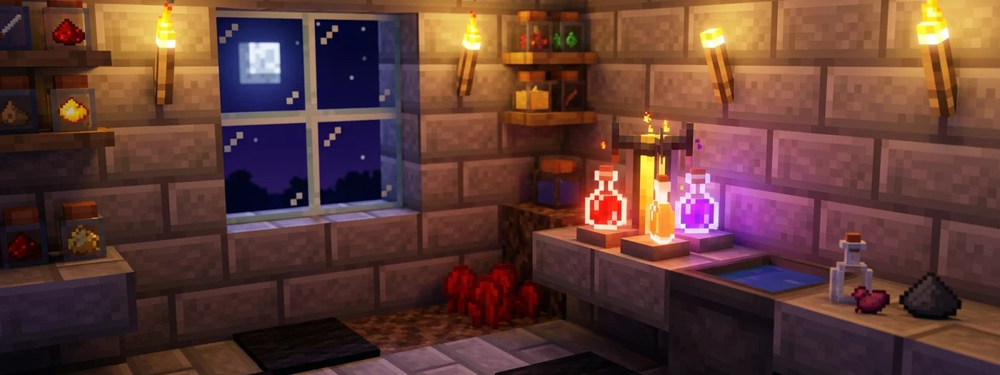
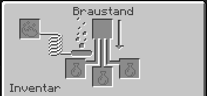

# 🧪 Tränke brauen

<figure><figcaption></figcaption></figure>

Tränke braust du auf der Cloud wie im normalen Minecraft. Hier erfährst du unter anderem, was du dafür brauchst und welche Zutat welchen Trank ergibt .

## Braustand und Lohenstaub

Den Braustand stellst du aus 1 Lohenrute und 3 Bruchstein her. Statt Bruchstein gehen auch Schwarzstein oder Bruchtiefenschiefer. Lohenruten bekommst du von Lohen in Netherfestungen. Mehr dazu findest du im Beitrag [Der Nether](https://wiki.griefergames.net/cloud/funktionen/spielmodus-citybuild/die-farmwelten#der-nether).
Im Braustand gibt es fünf Felder:

- **Oben links:** Lohenstaub. Er ist der Brennstoff. Ohne ihn braut der Braustand nicht. Ein Lohenstaub reicht für 20 Brauvorgänge. Aus 1 Lohenrute stellst du 2 Lohenstaub her.
- **Oben in der Mitte:** die Zutat.
- **Unten:** bis zu drei Flaschen. Pro Durchgang wird nur eine Zutat verbraucht, egal wie viele Flaschen drin sind. Fülle deshalb immer alle drei.

<figure><figcaption></figcaption></figure>

Glasflaschen stellst du aus 3 Glas her (ergibt 3 Flaschen). Fülle sie an einer Wasserquelle oder an einem Kessel mit Wasser.

## So braust du einen Trank

1. Lege Wasserflaschen in die unteren Felder.
2. Braue Netherwarze hinein. Daraus wird ein Seltsamer Trank, die Grundlage fast aller Tränke.
3. Braue die Effektzutat hinein, z. B. Zucker für Schnelligkeit.
4. Optional: Redstone-Staub für eine längere Wirkung oder Leuchtsteinstaub für eine stärkere.
5. Optional: Schwarzpulver macht daraus einen Wurftrank.

Ein Durchgang dauert 20 Sekunden.


Die meisten Effektzutaten ergeben in einer reinen Wasserflasche nur einen Trank ohne Wirkung. 
Die Netherwarze muss immer zuerst hinein. Netherwarzen findest du in Netherfestungen. Auf Seelensand kannst du sie anpflanzen und selbst vermehren.


## Die wichtigsten Tränke

Alle diese Tränke braust du aus einem Seltsamen Trank:

| Trank | Zutat | Wirkung | Länger | Stärker |
| :--- | :--- | :--- | :---: | :---: |
| **Befall** | Stein | Bei Schaden können Silberfischchen erscheinen | – | – |
| **Feuerresistenz** | Magmacreme | Kein Schaden durch Feuer und Lava. Unter Lava siehst du etwas weiter. | ✓ | – |
| **Heilung** | Glitzernde Melonenscheibe | Sofort Herzen zurück | – | ✓ |
| **Regeneration** | Ghast-Träne | Herzen kommen nach und nach zurück | ✓ | ✓ |
| **Stärke** | Lohenstaub | Mehr Schaden im Nahkampf | ✓ | ✓ |
| **Schnelligkeit** | Zucker | Schneller laufen | ✓ | ✓ |
| **Sprungkraft** | Hasenpfote | Höher springen | ✓ | ✓ |
| **Nachtsicht** | Goldene Karotte | Im Dunkeln alles hell sehen | ✓ | – |
| **Unterwasseratmung** | Kugelfisch | Unter Wasser keine Luft verlieren | ✓ | – |
| **Sanfter Fall** | Phantomhaut | Langsam fallen, kein Fallschaden | ✓ | – |
| **Schildkrötenmeister** | Schildkrötenpanzer | Viel weniger Schaden, aber sehr langsam | ✓ | ✓ |
| **Vergiftung** | Spinnenauge | Schaden über Zeit, tötet aber nicht | ✓ | ✓ |
| **Schleimen** | Schleimblock | Wer damit stirbt, hinterlässt zwei Schleime | – | – |
| **Weben** | Spinnennetz | Wer damit stirbt, hinterlässt Spinnennetze | – | – |
| **Windladung** | Böenrute | Wer damit stirbt, löst einen Windstoß aus | – | – |


**Ein Trank ist entweder verlängert oder verstärkt, nicht beides!** Mit Redstone-Staub wirken z. B. Feuerresistenz oder Schnelligkeit 8 statt 3 Minuten. Leuchtsteinstaub bringt Stufe II, die Wirkung hält dafür kürzer. 


<figure><figcaption>Grafische Übersicht der Tränke</figcaption></figure>

**Goldene Karotte** und **Glitzernde Melonenscheibe** stellst du aus einer Karotte bzw. Melonenscheibe und 8 Goldklumpen her. Magmacreme droppen Magmawürfel, oder du stellst sie aus Lohenstaub und einem Schleimball her.

## Umkehren mit dem Fermentierten Spinnenauge

Das **fermentierte Spinnenauge** stellst du aus Spinnenauge, braunem Pilz und Zucker her, in beliebiger Anordnung. 
Es dreht einen Trank um:

|  Aus.. | wird.. |
| --- | --- |
| Nachtsicht | Unsichtbarkeit |
| Schnelligkeit oder Sprungkraft | Langsamkeit |
| Heilung oder Vergiftung | Schaden |
| Wasserflasche | Schwäche |

## [#](#überschrift)Wurftränke, Verweiltränke und getränkte Pfeile

Neben den normalen Tränken zum Trinken kannst du deine gebrauten Tränke im Braustand oder an der Werkbank noch weiterverarbeiten, um mehrere Ziele gleichzeitig zu treffen oder Pfeile mit Effekten auszustatten.


Normalerweise erhältst du Drachenatem nur im Kampf gegen den Enderdrachen. Da es in den Farmwelten (Das Ende) auf GrieferGames jedoch keinen Enderdrachen gibt, kannst du Drachenatem dort nicht auf dem klassischen Weg farmen – Verweiltränke und getränkte Pfeile lassen sich daher nicht regulär über die Farmwelt erspielen.


### Wurftränke
* **Herstellung:** Braue **Schwarzpulver** in einen beliebigen Trank.
* **Wirkung:** Statt den Trank zu trinken, kannst du ihn werfen. Beim Aufprall wirkt der Effekt in einem Radius von bis zu **4 Blöcken** auf alle Spieler und Kreaturen – **auch auf dich selbst!**
* **Dauer:** Je näher ein Ziel am Aufprallpunkt steht, desto länger hält der Effekt an.

---

## Effekte wieder loswerden

Wenn du einen Trankeffekt vorzeitig beenden möchtest, kannst du einfach einen **Milcheimer** trinken.
**Milch** entfernt sofort alle aktiven Effekte – sowohl die negativen (wie Vergiftung) als auch die positiven (wie Stärke oder Feuerresistenz).


Auf Grundstücken (Plots) ist die Interaktion mit Tieren deaktiviert. Du kannst sie dort also nicht melken. 
Um an Milch zu gelangen, musst du Tiere in den Farmwelten suchen und dort melken. Weitere Details dazu findest du im Wiki-Artikel unter [Mechanik-Änderungen](https://wiki.griefergames.net/cloud/funktionen/mechanik-aenderungen#mobs-auf-grundst%C3%BCcken).


## Extras auf GrieferGames

- [Attribut-Tränke](https://wiki.griefergames.net/cloud/funktionen/custom-items/attribut-traenke): z. B. Trank der Ameise oder Trank des Riesen. Sie verändern kurz deine Eigenschaften, auch als Wurf- und Verweiltrank.
- [Perks](https://wiki.griefergames.net/cloud/funktionen/features/perks): Effekte wie Feuerresistenz, Nachtsicht oder Leuchten dauerhaft. Mit /perks schaltest du sie an und aus.
- [Trichter-System](https://wiki.griefergames.net/cloud/funktionen/features/trichter-system#effektfilter): Mit dem Effektfilter sortierst du Tränke nach ihrem Effekt.
- [Unbegrenzter Speicher](https://wiki.griefergames.net/cloud/funktionen/features/unbegrenzter-speicher): Für Tränke und getränkte Pfeile kannst du keinen unbegrenzten Speicher erstellen.
