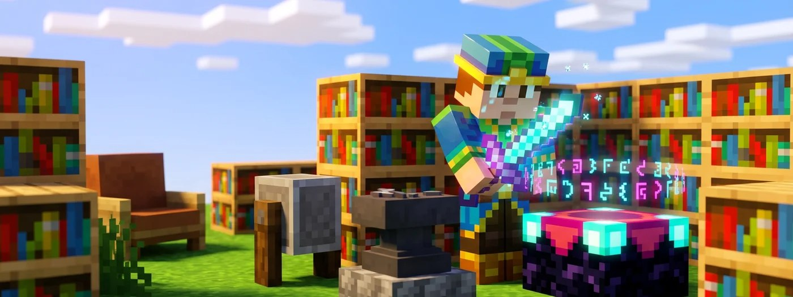

# ✨ Verzaubern & Reparieren

<figure><figcaption></figcaption></figure>

Verzaubern und Reparieren funktioniert auf der Cloud wie im normalen Minecraft. Hier erfährst du, wie du an gute Verzauberungen kommst, warum der Amboss irgendwann „Zu teuer!“ sagt und welche Regeln es auf GrieferGames zusätzlich gibt.

## Am Zaubertisch verzaubern

Für einen Zaubertisch brauchst du **1 Buch, 2 Diamanten** und **4 Obsidian**. Lege den Gegenstand in das linke Feld und **1 bis 3 Lapislazuli** in das rechte. Rechts erscheinen dann bis zu drei Angebote.
* **Mindestlevel:** Die Zahl rechts neben einem Angebot zeigt an, welches Erfahrungslevel du **mindestens** besitzen musst, um diese Verzauberung auszuwählen (z. B. Level 30 für die höchste Stufe).
* **Tatsächliche Kosten:** Dir werden beim Verzaubern **nicht** alle Level abgezogen, sondern – je nach gewähltem Angebot (oben, Mitte oder unten) – immer nur **1, 2 oder 3 Level** sowie genau **1, 2 oder 3 Lapislazuli**.
* **Angebote wechseln:** Die angezeigten Verzauberungen ändern sich erst, sobald du einen Gegenstand verzaubert hast. 


Wenn dir keines der aktuellen Angebote zusagt, verzaubere einfach ein Buch oder ein einfaches Holzwerkzeug auf der niedrigsten Stufe (für 1 Level und 1 Lapislazuli). Dadurch werden die Angebote für deine wertvollen Items neu ausgewürfelt!


## Bücherregale aufstellen

Ohne Bücherregale bietet der Zaubertisch nur schwache Verzauberungen an. Mit 15 Bücherregalen erreichst du die höchste Stufe mit Angeboten bis Level 30.

<figure><figcaption></figcaption></figure>

Um die maximale Stufe beim Verzaubern freizuschalten, stellst du Bücherregale mit **genau einem Block Abstand** rund um den Zaubertisch auf. 
Dabei dürfen sich die Regale entweder auf derselben Höhe wie der Tisch oder **einen Block höher** befinden. Achte unbedingt darauf, dass die Lücke zwischen dem Zaubertisch und den Bücherregalen komplett **frei bleibt** – selbst ein kleiner Gegenstand wie eine Fackel oder ein Teppich an dieser Stelle führt dazu, dass das dahinterliegende Regal nicht mehr mitgezählt wird.


Mit dem Zaubertisch kannst du auch Bücher verzaubern. Die verzauberten Bücher bringst du später mit dem Amboss auf einen Gegenstand.


## Mit dem Amboss

Der Amboss ist die perfekte Ergänzung zum Zaubertisch. Für jede Aktion am Amboss benötigst du ein paar Erfahrungslevel. Du hast dort vier Möglichkeiten:

* **Verzauberte Bücher nutzen:** Übertrage die Verzauberung von einem **verzauberten Buch** gezielt auf deinen Gegenstand.
* **Gegenstände kombinieren:** Lege zwei gleiche Gegenstände zusammen (z. B. zwei Diamantschwerter). Dabei wird ihre **Haltbarkeit addiert** und die **Verzauberungen beider Items werden kombiniert** bzw. aufgewertet.
* **Mit Material reparieren:** Repariere beschädigte Ausrüstung direkt mit dem passenden Grundmaterial (z. B. eine Diamantspitzhacke mit einzelnen Diamanten), ohne dass deine Verzauberungen verloren gehen.
* **Gegenstände umbenennen:** Gib jedem beliebigen Item im oberen Textfeld einen eigenen Namen.

Jedes Mal, wenn ein Gegenstand den Amboss benutzt, wird er für den nächsten Durchgang teurer. Dazu kommen die Kosten für das, was du gerade machst.

| Anzahl bisheriger Ambossnutzungen | Aufschlag beim nächsten Mal |
| :---: | :---: |
| 0 | + 0 Level |
| 1 | + 1 Level |
| 2 | + 3 Level |
| 3 | + 7 Level |
| 4 | + 15 Level |
| 5 | + 31 Level |

Liegen die Kosten bei 40 Level oder mehr, zeigt der Amboss „Zu teuer!“. Dann lässt sich der Gegenstand am Amboss nicht mehr bearbeiten, auch nicht mit sehr vielen Level.


Level sparen? Lege zuerst die verzauberten Bücher am Amboss untereinander zusammen und bringe das fertige Buch dann in einem Schritt auf den Gegenstand. Umbenennen zählt ebenfalls als Nutzung. Benenne den Gegenstand deshalb am besten zusammen mit dem letzten Schritt um.


Ein Amboss nutzt sich bei der Benutzung ab. Er bekommt erst Risse und geht irgendwann kaputt.

Nicht alle Verzauberungen vertragen sich miteinander. Einige Effekte schließen sich gegenseitig aus, sodass sie auch am Amboss nicht gemeinsam auf denselben Gegenstand gebracht werden können. Bei Werkzeugen musst du dich immer zwischen Behutsamkeit und Glück entscheiden. Auch bei Rüstungen gilt dieses Prinzip: Die vier Schutzarten Schutz, Feuerschutz, Explosionsschutz und Schussschutz lassen sich nicht auf einem Rüstungsteil mischen, ebenso wenig wie Wasserläufer und Eisläufer auf deinen Stiefeln.

Im Kampf verhält es sich ähnlich. Auf Schwertern und Äxten dulden sich die Schadensverzauberungen Schärfe, Bann und Nemesis der Gliederfüßer nicht untereinander. Bei Fernkampfwaffen schließen sich auf dem Bogen Reparatur und Unendlichkeit gegenseitig aus, während du dich bei der Armbrust zwischen Mehrfachschuss und Durchschuss sowie beim Dreizack zwischen Treue und Sog entscheiden musst.

## Mit dem Schleifstein

Der Schleifstein hat zwei Felder oben:

- **Ein Gegenstand:** Alle Verzauberungen werden entfernt, außer Flüchen. Du bekommst dafür etwas Erfahrung zurück.
- **Zwei gleiche Gegenstände:** Sie werden zu einem zusammengelegt und repariert, sogar mit etwas Bonus-Haltbarkeit. Die Verzauberungen gehen dabei verloren, Flüche bleiben.


Möchtest du **nur eine einzelne** Verzauberung entfernen, statt alle, nutze den [Verzauberungs-Entferner](https://wiki.griefergames.net/cloud/funktionen/custom-items/verzauberungs-upgrade-und-entferner#verzauberungs-entferner).


## Reparatur (Mending)

Gegenstände mit Reparatur reparieren sich mit Erfahrung. Jeder Erfahrungspunkt, den du einsammelst, geht zuerst in die Reparatur eines solchen Gegenstands. Das funktioniert mit allem, was du in der Hand, in der Zweithand oder als Rüstung trägst. Ein Erfahrungspunkt repariert zwei Haltbarkeitspunkte. Reparatur bekommst du nicht am Zaubertisch. Du findest sie als verzaubertes Buch beim Handel mit beim** Handel mit Bibliothekar-Dorfbewohnern**, beim **Angeln** oder in **Truhen** von Strukturen.


Hat ein Gegenstand eine Verzauberung über der höchsten Standardstufe, z. B. Schutz 10 oder Effizienz 7, wirkt Reparatur in der Regel nicht. Solche Gegenstände tragen meist den Fluch des Reparaturverlusts. Mehr dazu unter [Reparatur Verzauberung](https://wiki.griefergames.net/cloud/funktionen/mechanik-aenderungen/reparatur-verzauberung).


## Flüche

| Fluch | Wirkung |
| :--- | :--- |
| **Fluch der Bindung** | Das Rüstungsteil lässt sich nicht ausziehen, bis es kaputtgeht oder du stirbst. |
| **Fluch des Verschwindens** | Der Gegenstand verschwindet, wenn du stirbst. |
| **Fluch des Reparaturverlusts** | Gibt es nur auf GrieferGames. Der Gegenstand lässt sich nicht mit Reparatur reparieren. |

Flüche lassen sich weder mit dem Schleifstein noch mit dem Verzauberungs-Entferner entfernen.

## Die wichtigsten Verzauberungen

| Verzauberung | Was sie macht |
| :--- | :--- |
| **Effizienz** | Du baust schneller ab. |
| **Haltbarkeit** | Der Gegenstand nutzt sich langsamer ab. |
| **Behutsamkeit** | Du baust den Block selbst ab, statt seiner Drops. So bekommst du z. B. Erzblöcke, Glas oder Eis. |
| **Glück** | Erze wie Diamant, Kohle, Lapislazuli oder Redstone geben mehr Drops. Funktioniert auch bei Pflanzen und Kies. |
| **Plünderung** | Mobs lassen mehr fallen. Zählt nur, wenn du sie mit der Waffe in der Haupthand tötest. |
| **Schärfe** | Mehr Schaden mit Schwert und Axt. |
| **Schutz** | Weniger Schaden durch fast alles. |
| **Dornen** | Wer dich angreift, bekommt selbst Schaden. Nur auf Rüstung. |
| **Reparatur** | Repariert den Gegenstand mit Erfahrung (siehe oben). |

## Extras auf GrieferGames

- [Verzauberungs-Upgrade & Verzauberungs-Entferner](https://wiki.griefergames.net/cloud/funktionen/custom-items/verzauberungs-upgrade-und-entferner): eine Verzauberung um eine Stufe erhöhen oder einzeln entfernen
- [Gegenstandsrettung](https://wiki.griefergames.net/cloud/funktionen/features/gegenstandsrettung): schützt Werkzeuge vor dem Kaputtgehen und repariert sie dabei
- [Einmalige Gegenstandsreparatur](https://wiki.griefergames.net/cloud/funktionen/custom-items/einmalige-gegenstandsreparatur): repariert ein Item einmal vollständig, auch wenn der Amboss „Zu teuer!“ sagt
- [Super-Werkzeuge](https://wiki.griefergames.net/cloud/funktionen/custom-items/super-werkzeuge): Glück und Behutsamkeit wirken auf alle Blöcke im Abbaubereich
- [Perks](https://wiki.griefergames.net/cloud/funktionen/features/perks): Mit Keep XP behältst du deine Level, wenn du stirbst
